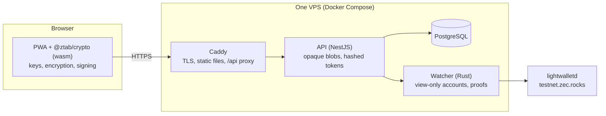

# ZTab


**A private bill splitter on shielded Zcash.** One person opens a tab, sends each friend a link, everyone pays their share in shielded ZEC, and the organizer withdraws the total. The server never learns who the participants are, what the tab is for, or what anyone owes, and it never holds a key that can move the money.

**Live demo (Zcash testnet):** https://ztab.dev

Built for ZECATHON 2026, track **Shielded Payments**.

## Try it

You need a Zcash **testnet** wallet with shielded (Orchard) sends and a little testnet ZEC (TAZ).

1. Get a wallet and TAZ. Tested on 2026-10-25: **Vizor Testnet** on macOS (the separate `Vizor-Testnet-macos.dmg` from `chainapsis/vizor-wallet` releases; the plain Vizor app is mainnet) paid a tab and received the withdraw. **Zingo** from the App Store on iPhone (switched to Testnet) now shows testnet funds; paying from it is not tested yet. The faucet is https://fauzec.com.
2. Open https://ztab.dev and create a tab: a title, a total in USD, the participants' names, and a mode.
   - **Group:** one link for everyone; everyone sees everyone's status.
   - **Individual:** one link per person; each sees only their own share.
3. Save the **admin link** (it is the only way back to the tab and its funds), then open a participant link.
4. Pay from your wallet by scanning the QR code or opening the `zcash:` link. The payment shows as seen within seconds of reaching the mempool and as **paid** after 3 confirmations.
5. Back on the admin page, once every payment has 10 confirmations (a few minutes on testnet), press **Withdraw**, enter your own shielded address, check the summary and confirm. The funds arrive in your wallet as one shielded transaction.

## How it works



- **Keys live in the link.** Creating a tab makes a random master key in the browser. Every other key (the tab's Zcash account, the encryption keys, the access tokens) is derived from it with HKDF. The admin link carries the master key in the URL fragment (`#a=…`), participant and group links carry only what they need (`#p=…`, `#g=…`). Browsers never send fragments to a server, and the app removes them from the address bar after reading.
- **One shielded address per participant.** Each participant pays to their own diversified Orchard address of the tab's account, so payments are told apart without memos and without linking participants on chain.
- **The server stores ciphertext.** Title, names, USD amounts and the withdraw address are sealed with AES-256-GCM in the browser. The API stores those blobs, SHA-256 hashes of the access tokens, and the tab's lifecycle state.
- **The watcher can see, not spend.** It imports each tab as a view-only account from its unified full viewing key (UFVK) and reports payments per address.
- **Withdraw is split by role.** The watcher builds and proves a PCZT that sweeps the tab to the organizer's address; the browser inspects it, re-checks recipient, amount and fee against what the organizer confirmed, and only then signs it with the spend key from the admin link. The watcher checks the signed PCZT and broadcasts it.

## Privacy model

| The server can learn | The server never learns |
|---|---|
| That a tab exists, its mode and participant count | Title, names, USD amounts, withdraw address |
| Incoming shielded payments to the tab's addresses (through the UFVK) and their confirmations | Who paid: payers send from their own shielded wallets |
| When the tab is withdrawn | The spend key, the master key, or any access token in clear |

What enforces it:

- Payments and the withdraw are shielded (Orchard); no transparent hop.
- A compromised server cannot redirect payments: at creation the PWA checks the watcher's participant addresses against its own derivation, and a participant page reads its address from the encrypted blob, which the server cannot alter. It cannot redirect the withdraw: `signPczt` refuses any PCZT that pays someone else, a different amount, or a higher fee (capped).
- No third-party requests (fonts, icons, QR and exchange rate are local or go through our API), no cookies, no analytics, `document.title` is always `ZTab`, no console output in production.
- Strict Content-Security-Policy without `'unsafe-eval'`, HSTS, `Referrer-Policy: no-referrer`; the Caddy error log drops URIs, headers and IPs, and there is no access log.
- Tested: an end-to-end test records every request of the create, pay and admin flows and asserts that no fragment, key, UFVK, title, name or amount leaves the browser.

Trade-off we accept: the server holds each tab's viewing key, so it sees amounts arriving at a tab (but not who sent them or what they are for). That is what lets the app show live payment status without the organizer running a wallet.

## Repository

| Package | What it is |
|---|---|
| [`pwa/`](pwa/README.md) | React progressive web app |
| [`crypto/`](crypto/README.md) | `@ztab/crypto`: key derivation, encryption, PCZT inspection and signing (Rust + wasm, TypeScript) |
| [`api/`](api/README.md) | NestJS API with PostgreSQL |
| [`watcher/`](watcher/README.md) | Rust service: view-only accounts, payment facts, PCZT sweeps |
| [`deploy/`](deploy/README.md) | Docker Compose, Caddy, server scripts and runbook |
| [`docs/superpowers/specs/`](docs/superpowers/specs/) | Design specs (Ukrainian) |

Stack: Rust 1.98 with librustzcash (NU7/Ironwood pre-release crates), wasm-bindgen, NestJS 12, Prisma 7, PostgreSQL 16, Vite 8, React 19, Tailwind 4, Caddy 2, Docker Compose.

## Run and test

Node 24, pnpm 11, Rust 1.98 and Docker.

```sh
pnpm install
pnpm -r typecheck && pnpm -r test     # TypeScript and Vitest suites
(cd watcher && cargo test)            # Rust; live testnet tests are #[ignore]d
bash deploy/rehearsal.sh              # the production stack on https://localhost + Playwright smoke
```

Each package README has its own run instructions. CI runs all of the above on every push and pull request, and publishes the images to GHCR (`ghcr.io/vitalikcholan/ztab-{api,watcher,pwa}`). To deploy your own copy, follow [`deploy/README.md`](deploy/README.md).

## Status and limits

- Testnet only. Mainnet needs the NU7 crates to be released and a security review.
- Payers need a wallet that sends shielded ZEC and handles `zcash:` (ZIP-321) requests; wallet support on testnet after NU7 is still uneven.
- A tab nobody opens for 30 days is deleted. Funds that arrive later stay on the tab key and can be recovered only with the admin link, outside the app.
- The demo depends on a public lightwalletd (`testnet.zec.rocks`); it can be switched in `deploy/.env` without a code change.
